# Diseño — Mesa de servicios de soporte tecnológico

| Campo | Valor |
|---|---|
| Proyecto | Mesa de servicios de soporte tecnológico (guía PF-02) |
| Documento | Actividad 3: diseño de la aplicación y de los servicios web |
| Requisitos | [`docs/requisitos.md`](requisitos.md) |
| Trazabilidad | [`docs/trazabilidad.md`](trazabilidad.md) |
| Versión | 1.0 |
| Fecha | 16-11-2026 |

Este documento describe lo que **está implementado**. Cada sección indica el punto de la Actividad 3 que cubre.

| Punto de la Actividad 3 | Sección |
|---|---|
| 1. Arquitectura (frontend, backend, API REST y persistencia) | 1 |
| 2. Modelo de datos | 2 |
| 3. Recorridos de los actores y prototipos de interfaz | 3 |
| 5. Reglas de negocio y restricciones de acceso | 4 |
| 4. Recursos de la API, formatos, validaciones y errores | 5 |
| 6. Decisiones técnicas y correspondencia con los requisitos | 6 y 7 |

---

## 1. Arquitectura

### 1.1 Vista general

La aplicación es una sola aplicación FastAPI que cumple dos papeles. Entrega las pantallas (HTML) y expone la API REST. Aun así, el frontend y el backend están separados: las pantallas solo traen la estructura HTML, y todos los datos viajan en JSON por la API, que verifica los permisos en cada solicitud (RNF-01).

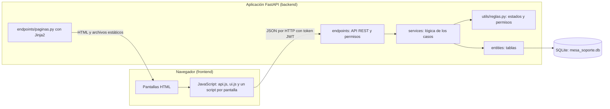

### 1.2 Componentes y responsabilidades

| Componente | Ubicación | Responsabilidad |
|---|---|---|
| Pantallas | `frontend/templates/` | Estructura HTML de cada pantalla (plantillas Jinja2 con un diseño base común) |
| Lógica de la interfaz | `frontend/static/js/` | `api.js` habla con la API y guarda la sesión; `ui.js` dibuja tablas y detalle; un script por pantalla |
| Entrega de pantallas | `backend/src/endpoints/paginas.py` | Rutas `/`, `/solicitante`, `/tecnico` y `/coordinador`. No consultan la base de datos |
| API REST | `backend/src/endpoints/` | Reciben la solicitud, verifican el token y los permisos, y responden |
| Servicios | `backend/src/services/` | Aplican las reglas, guardan en la base de datos y escriben el historial |
| Reglas del negocio | `backend/src/utils/reglas.py` | Roles, estados, transiciones y permisos (scopes). Es el único lugar donde se definen |
| Seguridad | `backend/src/utils/security.py` | Contraseñas con bcrypt, emisión y validación del JWT, verificación de scopes |
| Validación | `backend/src/schemas/` | Valida lo que entra y da forma a lo que sale |
| Entidades | `backend/src/entities/` | Tablas de la base de datos y sus restricciones |
| Persistencia | `backend/src/database/connection.py` | Conexión, sesión por solicitud y claves foráneas activas |

### 1.3 Tecnologías y justificación

| Capa | Tecnología | Justificación |
|---|---|---|
| Backend | Python y FastAPI | Valida los datos con Pydantic, resuelve la seguridad con dependencias y genera la documentación interactiva `/docs`, que sirve como herramienta de prueba de los endpoints |
| Frontend | Plantillas Jinja2 de FastAPI y JavaScript sin dependencias | Un solo proceso y un solo comando de arranque; sin instalar ni compilar nada más. El JavaScript consume la API REST, así que el frontend sigue separado de la lógica |
| Base de datos | SQLite con SQLAlchemy | Relacional, con claves foráneas y restricciones, y sin instalar un servidor. Cambiar de motor (por ejemplo PostgreSQL) solo exige cambiar `DATABASE_URL` en el `.env` |
| Autenticación | JWT (PyJWT) y bcrypt | Token con el usuario y sus scopes; contraseñas guardadas solo como hash |
| Configuración | `.env` y pydantic-settings | Los secretos no están en el código; `SECRET_KEY` es obligatoria y no tiene valor por defecto |

### 1.4 Organización del código y su justificación

```
mesa-soporte/
├── backend/
│   ├── seed.py              Crea las tablas y carga datos ficticios
│   └── src/
│       ├── main.py          Arma la aplicación FastAPI
│       ├── endpoints/       Rutas HTTP
│       ├── services/        Lógica de los casos
│       ├── entities/        Tablas
│       ├── schemas/         Validación de entrada y salida
│       ├── database/        Conexión a la base de datos
│       └── utils/           Reglas, seguridad, configuración y utilidades
├── frontend/
│   ├── templates/           Pantallas (Jinja2)
│   └── static/              CSS y JavaScript
├── docs/                    Requisitos, diseño y trazabilidad
├── evidencias/              Pruebas funcionales y capturas
├── verificar_instalacion.py Revisa que el proyecto esté completo en el computador
├── requirements.txt
└── .env.example             Plantilla de variables de entorno, sin secretos
```

La guía no impone una estructura de carpetas, así que se organizó por **responsabilidad**, en capas con una sola dirección de dependencia: `endpoints` usa `services`; `services` usa `entities` y `utils`; ninguna capa inferior conoce a la superior. Con esto:
- Un cambio de regla (por ejemplo, quién puede cerrar) se hace en un solo archivo, `reglas.py`.
- Las rutas HTTP son delgadas y no contienen lógica de negocio.
- Se puede cambiar el motor de base de datos sin tocar los servicios.
- Cada integrante puede trabajar en una carpeta distinta sin chocar con el otro, lo que facilita las ramas y los pull requests.

### 1.5 Atención de una solicitud: capas de control

El ejemplo es la asignación de un técnico. Muestra por cuántos controles pasa una acción de gestión antes de modificar la base de datos.

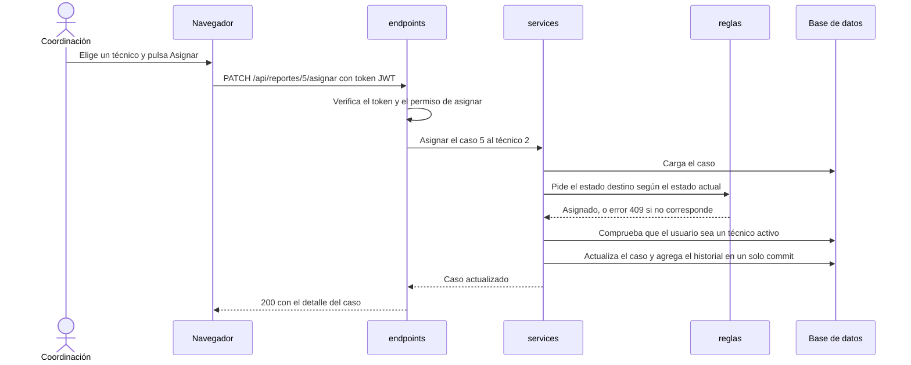

---

## 2. Modelo de datos

### 2.1 Diagrama entidad-relación

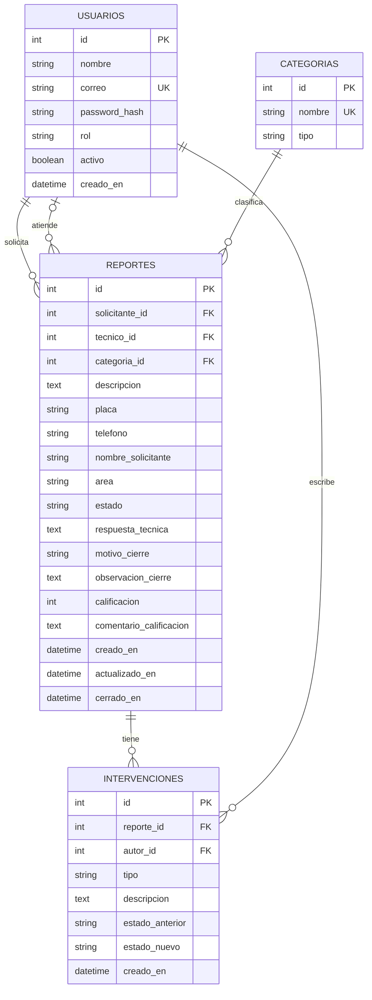

### 2.2 Relaciones

| Relación | Cardinalidad | Significado |
|---|---|---|
| `reportes.solicitante_id` → `usuarios.id` | Un usuario solicita muchos reportes; cada reporte tiene un solicitante | Quién reportó el caso |
| `reportes.tecnico_id` → `usuarios.id` | Un reporte tiene cero o un técnico; un técnico atiende muchos reportes | Responsable del caso. Es nulo hasta que la coordinación asigna |
| `reportes.categoria_id` → `categorias.id` | Una categoría clasifica muchos reportes; cada reporte tiene una | Clasificación (RN-02) |
| `intervenciones.reporte_id` → `reportes.id` | Un reporte tiene muchas intervenciones | Historial del caso |
| `intervenciones.autor_id` → `usuarios.id` | Un usuario escribe muchas intervenciones | Quién realizó la actuación |

### 2.3 Tablas, atributos y restricciones

**`usuarios`**

| Columna | Tipo | Restricciones |
|---|---|---|
| `id` | entero | Clave primaria |
| `nombre` | texto (120) | Obligatorio |
| `correo` | texto (120) | Obligatorio, **único**, indexado |
| `password_hash` | texto (255) | Obligatorio. Solo se guarda el hash bcrypt |
| `rol` | texto (20) | Obligatorio. `CHECK`: `solicitante`, `tecnico` o `coordinador` |
| `activo` | booleano | Por defecto verdadero |
| `creado_en` | fecha y hora | UTC |

**`categorias`**

| Columna | Tipo | Restricciones |
|---|---|---|
| `id` | entero | Clave primaria |
| `nombre` | texto (100) | Obligatorio, **único** |
| `tipo` | texto (12) | Obligatorio. `CHECK`: `incidente` o `solicitud` |

**`reportes`**

| Columna | Tipo | Restricciones |
|---|---|---|
| `id` | entero | Clave primaria |
| `solicitante_id` | entero | Obligatorio. Clave foránea a `usuarios`; indexada |
| `tecnico_id` | entero | Opcional. Clave foránea a `usuarios`; indexada |
| `categoria_id` | entero | Obligatorio. Clave foránea a `categorias` |
| `descripcion` | texto | Obligatorio (RN-01) |
| `placa` | texto (50) | Obligatorio (RN-01) |
| `telefono` | texto (20) | Obligatorio (RN-01) |
| `nombre_solicitante` | texto (120) | Obligatorio (RN-01) |
| `area` | texto (100) | Obligatorio (RN-01) |
| `estado` | texto (20) | Obligatorio, indexado. `CHECK`: `reportado`, `asignado`, `en_reparacion`, `terminado` o `cerrado` |
| `respuesta_tecnica` | texto | Opcional. Se llena al terminar |
| `motivo_cierre` | texto (20) | Opcional. `CHECK`: `resuelto`, `error` o `duplicado` |
| `observacion_cierre` | texto | Opcional. Se llena al cerrar |
| `calificacion` | entero | Opcional. `CHECK`: entre 1 y 5 |
| `comentario_calificacion` | texto | Opcional |
| `creado_en`, `actualizado_en` | fecha y hora | UTC |
| `cerrado_en` | fecha y hora | Opcional. UTC |

**`intervenciones`** (historial del caso)

| Columna | Tipo | Restricciones |
|---|---|---|
| `id` | entero | Clave primaria. Crece con el tiempo, así que ordena el historial |
| `reporte_id` | entero | Obligatorio. Clave foránea a `reportes`; indexada |
| `autor_id` | entero | Obligatorio. Clave foránea a `usuarios` |
| `tipo` | texto (20) | Obligatorio. `CHECK`: `registro`, `asignacion`, `nota`, `estado` o `cierre` |
| `descripcion` | texto | Obligatorio |
| `estado_anterior`, `estado_nuevo` | texto (20) | Opcionales. Se llenan en los cambios de estado |
| `creado_en` | fecha y hora | UTC |

### 2.4 Integridad de los datos

- **Claves foráneas activas.** SQLite no las aplica por defecto; la conexión ejecuta `PRAGMA foreign_keys=ON`, así que no se puede guardar un reporte con un usuario o una categoría inexistentes (RNF-02).
- **Restricciones `CHECK`** en roles, estados, motivos de cierre, tipos y calificación: la base rechaza valores inválidos aunque la API tuviera un error.
- **Un solo `commit` por operación.** El cambio de estado y su entrada de historial se guardan juntos o no se guardan.
- **El historial no se edita ni se borra.** No existe ningún endpoint que modifique o elimine una intervención (HU-04).
- **No hay `DELETE` sobre los casos.** Los casos erróneos o duplicados se cierran con observación (RN-05).

---

## 3. Recorridos de los actores y prototipos de interfaz

### 3.1 Recorrido completo de un caso

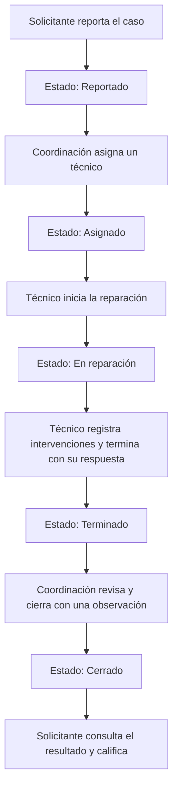

### 3.2 Recorrido de cada actor

**Solicitante** (`/solicitante`)
1. Ingresa con su correo y contraseña.
2. Completa el formulario (categoría, descripción, placa, nombre, área y teléfono) y lo envía.
3. Ve el caso en su lista con el estado "Reportado".
4. Consulta el detalle en cualquier momento: estado, técnico responsable, respuesta e historial.
5. Cuando el caso está cerrado, ve el resultado y lo califica de 1 a 5.

**Coordinación** (`/coordinador`)
1. En la pestaña **Por asignar** ve los casos reportados, elige un técnico y asigna.
2. En **Por cerrar** revisa los casos terminados por los técnicos y los cierra con motivo y observación.
3. En **Todos los casos** filtra por estado y abre cualquier detalle.
4. En **Consolidado** ve los totales por estado y las tablas de casos abiertos y cerrados.

**Técnico** (`/tecnico`)
1. Ve solo los casos que le asignaron.
2. Abre un caso y pulsa **Iniciar reparación**.
3. Registra las intervenciones que realiza.
4. Escribe su respuesta para el solicitante y marca el caso como **Terminado**.
5. El caso queda pendiente del cierre de la coordinación.

### 3.3 Prototipos de las pantallas

Son los bocetos de las cuatro pantallas implementadas. Las capturas de la aplicación en funcionamiento se guardan en `evidencias/pantallas/`.

**Ingreso (`/`)**

```
+--------------------------------------------+
|  Mesa de servicios de soporte tecnológico  |
|  Ingrese con su correo y contraseña.       |
|                                            |
|  Correo       [________________________]   |
|  Contraseña   [________________________]   |
|                                            |
|              [    Ingresar    ]            |
+--------------------------------------------+
```
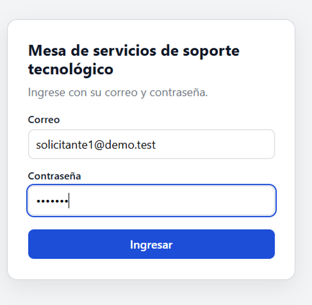

**Solicitante (`/solicitante`)**

```
+---------------------------------------------------------------------+
| Mesa de soporte · Solicitante                  Pedro Ruiz   [Salir] |
+---------------------------------------------------------------------+
| REPORTAR UN CASO              | MIS CASOS      [Todos v] [Actualizar] |
|                               |                                     |
| Categoría    [Seleccione v]   | N.º  Categoría        Estado   Fecha |
| Descripción  [.............]  | #3   Falla de red     Asignado [Ver] |
| Placa        [____________]   | #1   Falla de equipo  Cerrado  [Ver] |
| Su nombre    [____________]   |                                     |
| Área         [____________]   |                                     |
| Teléfono     [____________]   |                                     |
| [ Enviar reporte ]            |                                     |
+---------------------------------------------------------------------+
```
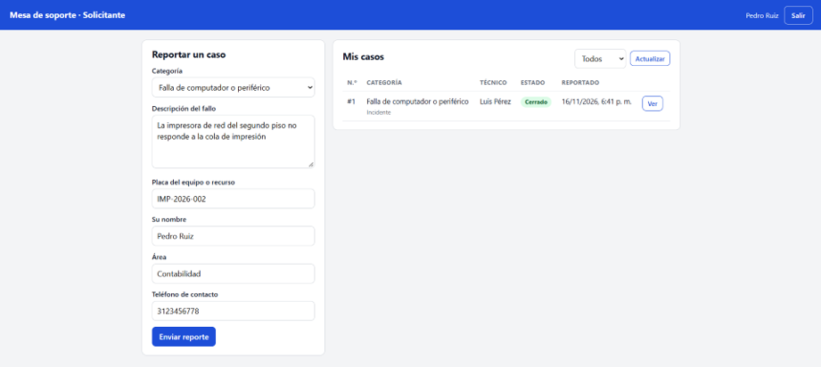

**Detalle de un caso (ventana, igual para los tres roles)**

```
+------------------------ Caso #1 --------------------------[Volver]+
| Estado: Cerrado         Tipo y categoría: Incidente · Falla equipo |
| Técnico: Luis Pérez     Solicitante: Pedro Ruiz (Matemáticas)      |
| Descripción del fallo .......................................      |
| Respuesta del técnico .......................................      |
| Cierre: Resuelto · 16 nov 2026 · observación final ..........      |
| Historial                                                          |
|   o Reporte · Pedro Ruiz · fecha                                   |
|   o Asignación · Marta Gómez · fecha                               |
|   o Cambio de estado · Luis Pérez · fecha                          |
|   o Cierre · Marta Gómez · fecha                                   |
| [Solicitante, caso cerrado] Puntuación [5 v] [Enviar calificación] |
+--------------------------------------------------------------------+
```
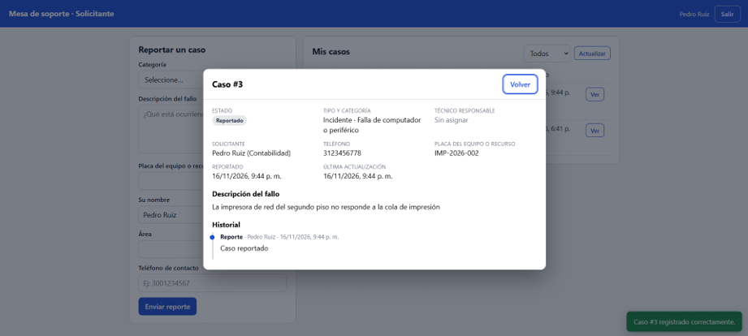

**Técnico (`/tecnico`)**

```
+---------------------------------------------------------------------+
| Mesa de soporte · Técnico                      Luis Pérez   [Salir] |
+---------------------------------------------------------------------+
| CASOS ASIGNADOS A MÍ            [Todos los estados v] [Actualizar]  |
| N.º  Categoría       Solicitante    Estado          Reportado       |
| #5   Falla de red    Laura Díaz     Asignado        14 nov   [Ver]  |
| #3   Falla equipo    Pedro Ruiz     En reparación   13 nov   [Ver]  |
+---------------------------------------------------------------------+
  Ventana del caso: [Iniciar reparación]  (si está Asignado)
                    Registrar una intervención [.....] [Agregar]
                    Respuesta para el solicitante [.....] [Terminado]
```

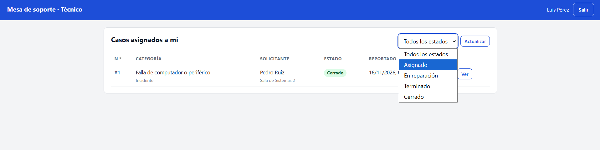

**Coordinación (`/coordinador`)**

```
+---------------------------------------------------------------------+
| Mesa de soporte · Coordinación               Marta Gómez   [Salir]  |
+---------------------------------------------------------------------+
| [Por asignar] [Por cerrar] [Todos los casos] [Consolidado] [Actualizar]|
+---------------------------------------------------------------------+
| CASOS REPORTADOS SIN TÉCNICO                                        |
| N.º  Categoría      Solicitante   Estado      Acciones              |
| #6   Falla de red   Pedro Ruiz    Reportado   [Técnico v][Asignar][Ver]|
+---------------------------------------------------------------------+
| Consolidado:  [Total 6] [Abiertos 4] [Cerrados 2] [por estado ...]  |
|               Tabla de casos abiertos  /  Tabla de casos cerrados   |
+---------------------------------------------------------------------+
  Ventana del caso (Por cerrar): Motivo [Resuelto v]
                    Observación final [.....]   [Cerrar caso]
```
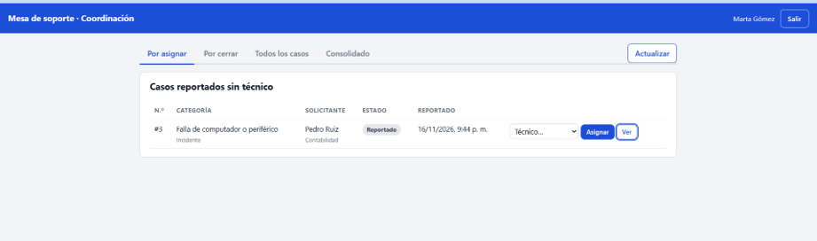
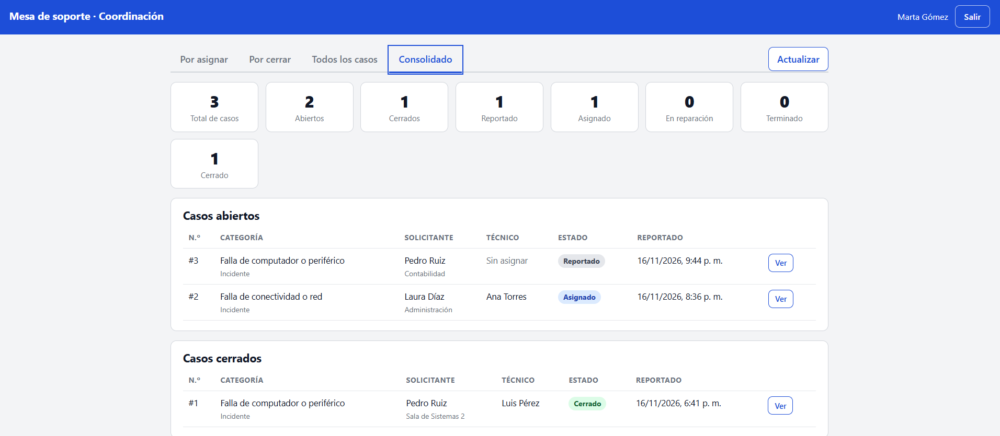

### 3.4 Validación en la interfaz

El formulario de reporte valida en el navegador los mismos límites que el servidor (RNF-03): categoría elegida, descripción de al menos 5 caracteres, placa, nombre, área y teléfono de 7 a 15 dígitos. Es una ayuda para el usuario; la validación que protege los datos es la del servidor, porque una solicitud puede enviarse sin pasar por la interfaz.

---

## 4. Reglas de negocio y restricciones de acceso

### 4.1 Ciclo de vida del caso

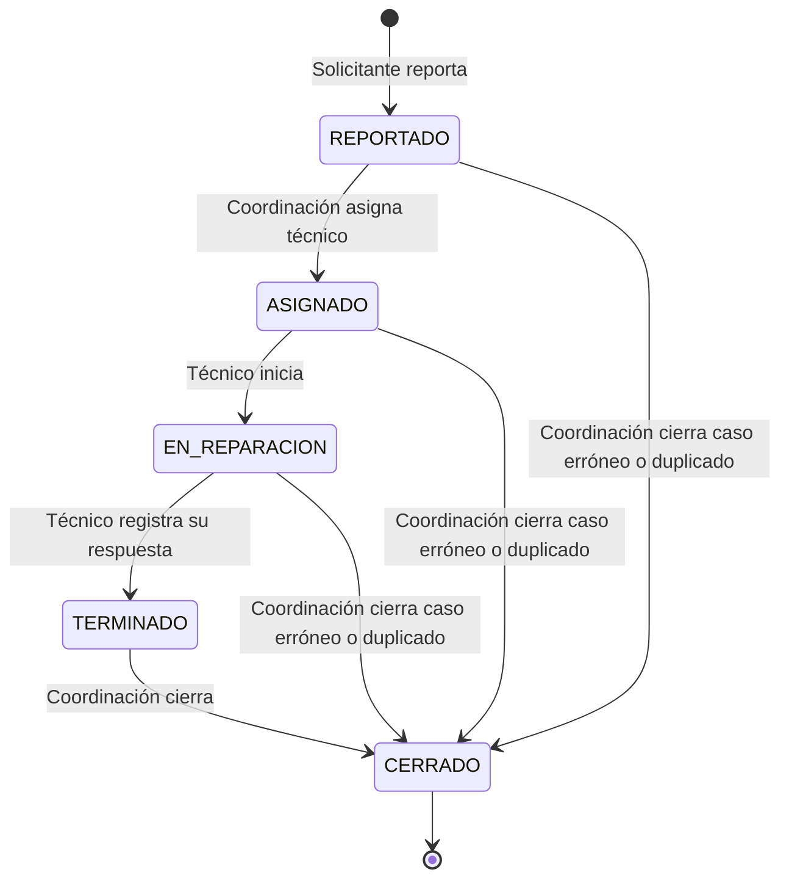

| Acción | Cambio de estado | Quién (permiso) | Condición | Endpoint | Entrada en el historial |
|---|---|---|---|---|---|
| Reportar | (nuevo) → Reportado | Solicitante (`reportes:crear`) | Datos válidos y categoría existente | `POST /api/reportes` | `registro`: "Caso reportado" |
| Asignar | Reportado → Asignado | Coordinación (`reportes:asignar`) | Usuario técnico y activo | `PATCH .../asignar` | `asignacion`: "Caso asignado al técnico ..." |
| Iniciar | Asignado → En reparación | Técnico asignado (`reportes:intervenir`) | | `PATCH .../iniciar` | `estado`: "El técnico inició la reparación" |
| Intervenir | Sin cambio | Técnico asignado (`reportes:intervenir`) | Caso no cerrado | `POST .../intervenciones` | `nota`: texto del técnico |
| Terminar | En reparación → Terminado | Técnico asignado (`reportes:intervenir`) | Respuesta de al menos 5 caracteres | `PATCH .../terminar` | `estado`: "Reparación terminada. Respuesta al solicitante: ..." |
| Cerrar como resuelto | Terminado → Cerrado | Coordinación (`reportes:cerrar`) | Observación de al menos 3 caracteres | `PATCH .../cerrar` con motivo `resuelto` | `cierre`: "Caso cerrado (resuelto). Observación: ..." |
| Cerrar erróneo o duplicado | Cualquier estado abierto → Cerrado | Coordinación (`reportes:cerrar`) | Observación de al menos 3 caracteres | `PATCH .../cerrar` con motivo `error` o `duplicado` | `cierre` |
| Calificar | Sin cambio | Solicitante dueño (`reportes:calificar`) | Caso cerrado y sin calificación previa | `POST .../calificacion` | No genera entrada |

Un caso cerrado no admite ninguna otra transición, ni nuevas intervenciones (RF-07). La única escritura posible sobre un caso cerrado es la calificación del solicitante, que no modifica el caso sino que lo evalúa.

### 4.2 Permisos por rol

Los permisos (scopes) viajan dentro del token JWT y se definen en `utils/reglas.py`.

| Permiso | Solicitante | Técnico | Coordinación |
|---|---|---|---|
| `reportes:crear` | Sí | | |
| `reportes:leer_propios` | Sí | | |
| `reportes:calificar` | Sí | | |
| `reportes:leer_asignados` | | Sí | |
| `reportes:intervenir` | | Sí | |
| `reportes:leer_todos` | | | Sí |
| `reportes:asignar` | | | Sí |
| `reportes:cerrar` | | | Sí |
| `reportes:consolidado` | | | Sí |
| `usuarios:listar` | | | Sí |

Qué ve cada rol en `GET /api/reportes`: el solicitante, sus casos; el técnico, los casos que tiene asignados; la coordinación, todos.

### 4.3 Dónde se aplica cada regla de negocio

| Regla | Dónde se aplica |
|---|---|
| RN-01 Cinco datos obligatorios | `schemas/reporte.py::ReporteCrear` (servidor); validación del formulario (`solicitante.js`); columnas obligatorias en `entities/reporte.py` |
| RN-02 Categoría obligatoria | `ReporteCrear.categoria_id`; `services/reportes.py::crear_reporte` comprueba que exista; clave foránea en la base |
| RN-03 Ciclo lineal | `utils/reglas.py::TRANSICIONES` y `estado_destino()`; restricción `CHECK` de estados |
| RN-04 Solo la coordinación asigna | Permiso `reportes:asignar` en `PATCH .../asignar` |
| RN-05 Cierre | Permiso `reportes:cerrar`; `estado_destino()` bloquea todo desde Cerrado; no existe `DELETE` ni reapertura |
| RN-06 Control de acceso con JWT | `utils/security.py::obtener_sesion`, usada en cada endpoint protegido |
| RF-07 Caso cerrado bloqueado | `reglas.estado_destino()` y `reglas.validar_intervencion_permitida()`; error 409 |

### 4.4 Capas de defensa

Una acción de gestión pasa, en orden, por estos controles. Si uno falla, no se modifica nada:

1. **Interfaz:** la pantalla solo ofrece las acciones que corresponden al rol y al estado, y valida lo básico.
2. **Token JWT:** debe existir y ser válido (401 si no).
3. **Permiso (scope):** el token debe incluir el permiso que exige el endpoint (403 si no).
4. **Propiedad:** el técnico debe ser el asignado al caso; quien consulta debe ser el solicitante, el técnico asignado o la coordinación; quien califica debe ser el solicitante del caso (403 si no).
5. **Estado del caso:** la acción debe ser válida para el estado actual (409 si no).
6. **Validación de los datos:** longitudes, tipos y valores permitidos (422 si no).
7. **Base de datos:** claves foráneas y restricciones `CHECK`.

### 4.5 Autenticación

- Se inicia sesión con `POST /api/auth/login` (correo y contraseña). La contraseña se compara con el hash bcrypt guardado.
- El token usa el algoritmo HS256, vence a los 60 minutos y se firma con `SECRET_KEY`, que solo existe como variable de entorno.
- El payload contiene el identificador del usuario, su rol y sus permisos:

```json
{
  "sub": "4",
  "rol": "solicitante",
  "scopes": ["reportes:crear", "reportes:leer_propios", "reportes:calificar"],
  "exp": 1794790800
}
```

- El navegador guarda el token en `sessionStorage`, que se borra al cerrar la pestaña, y lo envía en la cabecera `Authorization: Bearer <token>`.
- Las rutas de las pantallas (`/`, `/solicitante`, ...) son públicas porque solo entregan HTML. El JavaScript redirige al ingreso si no hay sesión, y la API es la que protege los datos.
- El mensaje de error del ingreso es el mismo para un correo inexistente y para una contraseña incorrecta, para no revelar qué usuarios existen. Los errores inesperados responden un mensaje genérico y el detalle técnico queda solo en el registro del servidor.

---

## 5. Especificación de la API REST

### 5.1 Convenciones

| Aspecto | Detalle |
|---|---|
| Dirección base | `http://127.0.0.1:8000`; todas las rutas de la API empiezan por `/api` |
| Formato | JSON en UTF-8. El inicio de sesión recibe un formulario (`username` y `password`) |
| Fechas | ISO 8601 en UTC, por ejemplo `2026-11-16T15:00:00+00:00` |
| Autenticación | Cabecera `Authorization: Bearer <token>` en todas las rutas excepto el inicio de sesión |
| Documentación interactiva | `/docs` (Swagger), generada a partir del código |
| Métodos | `GET` consulta, `POST` crea, `PATCH` cambia el estado de un caso. No se usan `PUT` ni `DELETE`: el proceso no permite reemplazar ni eliminar casos |
| Errores | `{"detail": "mensaje"}`. Para datos inválidos (422), `detail` es una lista con el campo y el motivo |

### 5.2 Resumen de endpoints

| Método | Ruta | Quién | Éxito | Errores posibles |
|---|---|---|---|---|
| POST | `/api/auth/login` | Todos | 200 | 401, 422 |
| GET | `/api/auth/me` | Sesión válida | 200 | 401 |
| GET | `/api/categorias` | Sesión válida | 200 | 401 |
| GET | `/api/usuarios/tecnicos` | Coordinación | 200 | 401, 403 |
| POST | `/api/reportes` | Solicitante | 201 | 401, 403, 422 |
| GET | `/api/reportes` | Sesión válida (cada rol ve lo suyo) | 200 | 401, 422 |
| GET | `/api/reportes/{id}` | Quien tenga acceso al caso | 200 | 401, 403, 404 |
| GET | `/api/reportes/{id}/historial` | Quien tenga acceso al caso | 200 | 401, 403, 404 |
| PATCH | `/api/reportes/{id}/asignar` | Coordinación | 200 | 401, 403, 404, 409, 422 |
| PATCH | `/api/reportes/{id}/iniciar` | Técnico asignado | 200 | 401, 403, 404, 409 |
| POST | `/api/reportes/{id}/intervenciones` | Técnico asignado | 201 | 401, 403, 404, 409, 422 |
| PATCH | `/api/reportes/{id}/terminar` | Técnico asignado | 200 | 401, 403, 404, 409, 422 |
| PATCH | `/api/reportes/{id}/cerrar` | Coordinación | 200 | 401, 403, 404, 409, 422 |
| POST | `/api/reportes/{id}/calificacion` | Solicitante dueño | 200 | 401, 403, 404, 409, 422 |
| GET | `/api/consolidado` | Coordinación | 200 | 401, 403 |

### 5.3 Códigos de error y mensajes

| Código | Cuándo | `detail` |
|---|---|---|
| 401 | Falta el token, es inválido o venció | "Credenciales no válidas o sesión vencida" |
| 401 | Correo o contraseña incorrectos en el ingreso | "Correo o contraseña incorrectos" |
| 403 | El rol no tiene el permiso del endpoint | "No tiene permisos para esta operación" |
| 403 | Consulta un caso que no es suyo ni de su asignación | "No tiene permiso para ver este caso" |
| 403 | Un técnico que no es el asignado actúa sobre el caso | "Solo el técnico asignado a este caso puede realizar esta acción" |
| 403 | Califica alguien distinto al solicitante | "Solo el solicitante del caso puede calificarlo" |
| 404 | El caso no existe | "El caso solicitado no existe" |
| 409 | El caso está cerrado | "El caso está cerrado: no admite cambios de estado ni nuevas intervenciones." |
| 409 | La acción no corresponde al estado actual | "No se puede ejecutar la acción 'asignar' sobre un caso en estado 'Asignado'." (el texto cambia con la acción y el estado) |
| 409 | Califica un caso que aún no está cerrado | "La calificación solo se habilita cuando el caso está cerrado" |
| 409 | El caso ya fue calificado | "Este caso ya fue calificado" |
| 422 | La categoría no existe | "La categoría indicada no existe" |
| 422 | El usuario indicado no es un técnico válido | "El usuario indicado no es un técnico válido" |
| 422 | Un dato no cumple su regla de validación | Lista con el campo y el motivo (ver 5.4) |
| 500 | Error inesperado del servidor | "Error interno del servidor" |

### 5.4 Validaciones de los datos de entrada

Antes de validar, se recortan los espacios al inicio y al final de los textos.

| Operación | Campo | Regla |
|---|---|---|
| Reportar | `categoria_id` | Entero mayor que 0 que exista en `categorias` |
| | `descripcion` | Texto de 5 a 2000 caracteres |
| | `placa` | Texto de 1 a 50 caracteres |
| | `telefono` | De 7 a 15 dígitos, sin contar espacios ni guiones; un `+` inicial es opcional. Se guarda sin espacios ni guiones. Mensaje: "El teléfono debe tener entre 7 y 15 dígitos (puede iniciar con +)" |
| | `nombre_solicitante` | Texto de 2 a 120 caracteres |
| | `area` | Texto de 2 a 100 caracteres |
| Asignar | `tecnico_id` | Entero mayor que 0 de un usuario técnico y activo |
| Intervenir | `descripcion` | Texto de 3 a 2000 caracteres |
| Terminar | `respuesta` | Texto de 5 a 2000 caracteres |
| Cerrar | `motivo` | `resuelto`, `error` o `duplicado`. `resuelto` solo desde Terminado |
| | `observacion` | Texto de 3 a 1000 caracteres |
| Calificar | `puntuacion` | Entero de 1 a 5 |
| | `comentario` | Opcional, hasta 500 caracteres |
| Listar | `estado` (parámetro) | `reportado`, `asignado`, `en_reparacion`, `terminado` o `cerrado` |
| | `grupo` (parámetro) | `abiertos` o `cerrados` |

Ejemplo de respuesta 422 cuando falta un dato:

```json
{
  "detail": [
    {"type": "missing", "loc": ["body", "placa"], "msg": "Field required", "input": {"...": "..."}}
  ]
}
```

### 5.5 Modelos de respuesta

**Usuario** (`UsuarioSalida`)

```json
{"id": 4, "nombre": "Pedro Ruiz", "correo": "solicitante1@demo.test", "rol": "solicitante"}
```

**Caso en detalle** (`ReporteDetalle`). Lo devuelven la creación, el detalle y todas las acciones de gestión.

```json
{
  "id": 1,
  "estado": "terminado",
  "categoria": {"id": 1, "nombre": "Falla de computador o periférico", "tipo": "incidente"},
  "placa": "PC-0456",
  "nombre_solicitante": "Pedro Ruiz",
  "area": "Matemáticas",
  "solicitante": {"id": 4, "nombre": "Pedro Ruiz", "correo": "solicitante1@demo.test", "rol": "solicitante"},
  "tecnico": {"id": 2, "nombre": "Luis Pérez", "correo": "tecnico1@demo.test", "rol": "tecnico"},
  "creado_en": "2026-11-16T15:00:00+00:00",
  "actualizado_en": "2026-11-16T17:30:00+00:00",
  "cerrado_en": null,
  "descripcion": "El computador no enciende",
  "telefono": "3001234567",
  "respuesta_tecnica": "Se reemplazó la fuente de poder",
  "motivo_cierre": null,
  "observacion_cierre": null,
  "calificacion": null,
  "comentario_calificacion": null,
  "intervenciones": [
    {
      "id": 1,
      "tipo": "registro",
      "descripcion": "Caso reportado",
      "estado_anterior": null,
      "estado_nuevo": "reportado",
      "creado_en": "2026-11-16T15:00:00+00:00",
      "autor": {"id": 4, "nombre": "Pedro Ruiz", "correo": "solicitante1@demo.test", "rol": "solicitante"}
    }
  ]
}
```

**Caso en lista** (`ReporteResumen`) tiene los mismos campos hasta `cerrado_en`, sin la descripción, el teléfono, el resultado ni las intervenciones.

### 5.6 Detalle de los endpoints

**`POST /api/auth/login`** — Inicia sesión.
- Entrada (formulario): `username` (el correo) y `password`.
- Salida 200:

```json
{
  "access_token": "<token JWT>",
  "token_type": "bearer",
  "usuario": {"id": 4, "nombre": "Pedro Ruiz", "correo": "solicitante1@demo.test", "rol": "solicitante"},
  "scopes": ["reportes:crear", "reportes:leer_propios", "reportes:calificar"]
}
```

**`GET /api/auth/me`** — Devuelve el usuario de la sesión (`UsuarioSalida`).

**`GET /api/categorias`** — Lista las categorías: `[{"id": 1, "nombre": "...", "tipo": "incidente"}]`.

**`GET /api/usuarios/tecnicos`** — Lista los técnicos activos, para el selector de asignación: `[{"id": 2, "nombre": "Luis Pérez", ...}]`.

**`POST /api/reportes`** — Reporta un caso (CA-01).
- Entrada:

```json
{
  "categoria_id": 1,
  "descripcion": "El computador no enciende",
  "placa": "PC-0456",
  "nombre_solicitante": "Pedro Ruiz",
  "area": "Matemáticas",
  "telefono": "300 123 4567"
}
```

- Salida 201: el caso (`ReporteDetalle`) en estado `reportado`, sin técnico, con una entrada `registro` en el historial. El teléfono queda guardado como `3001234567`.
- El solicitante del caso es el usuario del token; no se envía en el cuerpo.

**`GET /api/reportes`** — Lista los casos que el rol puede ver, del más reciente al más antiguo (`ReporteResumen`). Parámetros opcionales: `estado` y `grupo`.

**`GET /api/reportes/{id}`** — Detalle de un caso (CA-03, CA-05): estado, técnico responsable, resultado e historial.

**`GET /api/reportes/{id}/historial`** — Las intervenciones del caso en orden cronológico (CA-04): `[{"id": 1, "tipo": "registro", ...}]`.

**`PATCH /api/reportes/{id}/asignar`** — Asigna un técnico (CA-02).
- Entrada: `{"tecnico_id": 2}`
- Salida 200: el caso en estado `asignado`, con el técnico y una entrada `asignacion`.

**`PATCH /api/reportes/{id}/iniciar`** — Inicia la reparación. Sin cuerpo. Salida 200: el caso en `en_reparacion`.

**`POST /api/reportes/{id}/intervenciones`** — Registra una intervención (CA-04).
- Entrada: `{"descripcion": "Revisé la fuente de poder y está dañada"}`
- Salida 201: la intervención con su `tipo` `nota`, su autor y su fecha.

**`PATCH /api/reportes/{id}/terminar`** — Termina la reparación.
- Entrada: `{"respuesta": "Se reemplazó la fuente de poder"}`
- Salida 200: el caso en `terminado`, con `respuesta_tecnica`.

**`PATCH /api/reportes/{id}/cerrar`** — Cierra el caso (CA-05). Una vez cerrado no se puede reabrir.
- Entrada: `{"motivo": "resuelto", "observacion": "Caso verificado con el usuario"}`
- Salida 200: el caso en `cerrado`, con `motivo_cierre`, `observacion_cierre` y `cerrado_en`.

**`POST /api/reportes/{id}/calificacion`** — Califica el servicio (RF-11).
- Entrada: `{"puntuacion": 5, "comentario": "Atención rápida"}`
- Salida 200: el caso con `calificacion` y `comentario_calificacion`.

**`GET /api/consolidado`** — Vista de coordinación (CA-06, RF-09).

```json
{
  "total": 3,
  "abiertos": 2,
  "cerrados": 1,
  "por_estado": {"reportado": 1, "asignado": 0, "en_reparacion": 1, "terminado": 0, "cerrado": 1},
  "casos_abiertos": ["... ReporteResumen ..."],
  "casos_cerrados": ["... ReporteResumen ..."]
}
```

---

## 6. Decisiones técnicas

| # | Decisión | Justificación | Requisitos |
|---|---|---|---|
| D-01 | Cliente y servidor separados: el frontend solo entrega HTML y el JavaScript consume la API | Cumple "interfaz que consuma la API"; permite cambiar la interfaz sin tocar la lógica | RNF-01 |
| D-02 | FastAPI como framework de backend y de entrega de pantallas | Validación y seguridad integradas; documentación de la API generada automáticamente para las pruebas | RNF-01, RNF-06 |
| D-03 | Plantillas Jinja2 y JavaScript sin dependencias para el frontend | Un solo proceso y un solo comando; sin instalar ni compilar paquetes de JavaScript | RNF-01 |
| D-04 | SQLite con SQLAlchemy, con claves foráneas activadas | Base relacional sin servidor; portable a otro motor cambiando `DATABASE_URL` | RNF-02 |
| D-05 | JWT con los permisos (scopes) dentro del payload | La API decide sin consultar la base de datos qué puede hacer cada rol | RF-10, RNF-06, RN-06 |
| D-06 | Contraseñas con bcrypt | Nunca se guarda ni se devuelve la contraseña, solo su hash | RF-10 |
| D-07 | Reglas del negocio centralizadas en `utils/reglas.py` | Un solo lugar define roles, estados, transiciones y permisos; evita reglas duplicadas | RN-03, RN-04, RN-05 |
| D-08 | Una sola operación de base de datos por acción (un `commit`) | El estado y su historial se guardan juntos o no se guardan | CA-04, RF-07 |
| D-09 | Historial append-only con eventos de gestión y notas | Evidencia verificable de todas las actuaciones, sin sobrescritura | HU-04, CA-04 |
| D-10 | Sin `DELETE`, `PUT` ni reapertura | El proceso no permite eliminar ni reabrir casos; el CRUD genérico no representa el proceso | RN-05, RF-07 |
| D-11 | Validación en servidor y en la interfaz | El servidor protege los datos aunque la solicitud no venga de la interfaz | RNF-03 |
| D-12 | Secretos solo en variables de entorno; `.env` fuera de Git y `.env.example` sin valores reales | La guía y el Word prohíben subir credenciales | RNF-04 |
| D-13 | Datos de prueba ficticios; la clave de prueba sale del `.env` (`DEMO_PASSWORD`) | No hay contraseñas escritas en el código | RNF-04 |
| D-14 | Fechas en UTC | Evita ambigüedades de zona horaria; el navegador las convierte | RF-05 |
| D-15 | Errores genéricos hacia el cliente y detalle en el registro del servidor | No se revela información sensible | Guía, aspectos de seguridad |
| D-16 | Ramas y pull requests para integrar el trabajo | Evidencia de la colaboración y de la revisión entre integrantes | RNF-05 |

Las decisiones del equipo que el Word no cubría (tabla de categorías, tipos de intervención, formato del teléfono, cierre anticipado y otras) están listadas como supuestos en [`docs/requisitos.md`](requisitos.md), sección 11.

---

## 7. Correspondencia entre requisitos y diseño

| Requisito | Dónde se resuelve en el diseño | Implementación |
|---|---|---|
| RF-01 Registrar un caso con los cinco datos | 5.4, 5.6 `POST /api/reportes` | `schemas/reporte.py::ReporteCrear`, `services/reportes.py::crear_reporte`, `solicitante.js` |
| RF-02 Categoría al crear | 2.3, 5.4 | `entities/categoria.py`, `services/reportes.py::crear_reporte` |
| RF-03 Coordinación asigna técnico | 4.1, 5.6 `asignar` | `services/reportes.py::asignar`, scope `reportes:asignar` |
| RF-04 Responsable y estado "Asignado" | 4.1 | `entities/reporte.py` (`tecnico_id`, `estado`) |
| RF-05 Intervenciones con fecha | 2.3, 5.6 `intervenciones` | `entities/intervencion.py`, `services/reportes.py::registrar_intervencion` |
| RF-06 En reparación y Terminado | 4.1, 5.6 `iniciar` y `terminar` | `services/reportes.py::iniciar`, `terminar` |
| RF-07 Caso cerrado bloqueado | 4.1, 4.3 | `utils/reglas.py::estado_destino`, `validar_intervencion_permitida` |
| RF-08 Solicitante consulta estado, técnico y resultado | 4.2, 5.6 `detalle` | `services/reportes.py::obtener_reporte`, `ui.js::renderDetalle` |
| RF-09 Vista consolidada | 3.3, 5.6 `consolidado` | `services/reportes.py::consolidado`, `coordinador.js` |
| RF-10 Autenticación con JWT y scopes | 4.5 | `utils/security.py`, `endpoints/auth.py` |
| RF-11 Calificación solo con el caso cerrado | 4.1, 5.6 `calificacion` | `services/reportes.py::calificar` |
| RN-01 a RN-06 | 4.3 | Ver la tabla 4.3 |
| RNF-01 Cliente-servidor | 1.1, 1.4 | Carpetas `frontend/` y `backend/` |
| RNF-02 Base relacional con integridad | 2.4 | `entities/`, `database/connection.py` |
| RNF-03 Validación en frontend y servidor | 3.4, 5.4 | `schemas/`, `solicitante.js` |
| RNF-04 Variables de entorno fuera del repositorio | 1.3, 6 (D-12, D-13) | `.env.example`, `.gitignore`, `utils/config.py` |
| RNF-05 Control de versiones | 6 (D-16) | Historial de ramas y pull requests en GitHub |
| RNF-06 JWT con scopes en el payload | 4.2, 4.5 | `utils/security.py::crear_token`, `utils/reglas.py::SCOPES_POR_ROL` |
