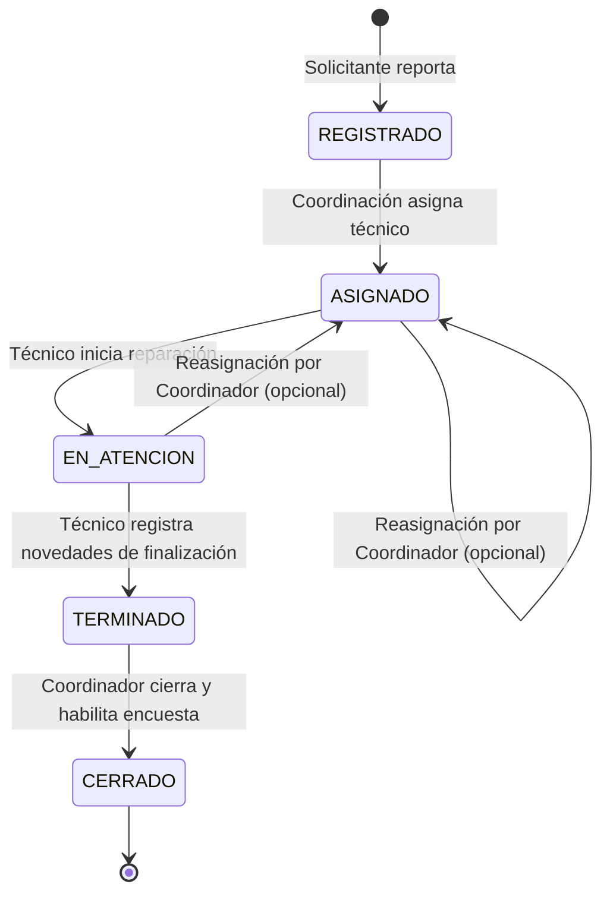

# Requisitos — PF-02 Mesa de servicios de soporte tecnológico

| Campo | Valor | 
| ----- | ----- | 
| Proyecto | Mesa de servicios de soporte tecnológico (guía PF-02) | 
| Asignatura | Aplicaciones y Servicios Web | 
| Equipo | Samuel Montoya, Andrea Vargas | 
| Versión | 1.0 — **Para aprobación del docente** | 
| Fecha | 11-11-2026 | 

## Cómo leer este documento

Cada elemento lleva una etiqueta que indica de dónde sale:

| Etiqueta | Significado | 
| ----- | ----- | 
| **[GUÍA]** | Viene de la guía PF-02 | 
| **[DOCENTE]** | Confirmado por el docente en entrevistas o chat | 
| **[EQUIPO]** | Decisión tecnológica y arquitectónica del equipo | 
| **[PROPUESTA]** | Lógica de negocio definida por el equipo para cubrir vacíos | 

## 1. Contexto y alcance

**Problema [GUÍA].** Una institución educativa tiene un equipo de soporte tecnológico que atiende a docentes y personal administrativo. Los reportes llegan por correo o llamadas, sin registro unificado ni seguimiento visible.

**Solución requerida [GUÍA].** Una aplicación web (interfaz, API REST y base de datos) que registre y dé seguimiento a los casos desde el reporte hasta el cierre, conservando las intervenciones realizadas y el resultado comunicado al usuario.

**Alcance mínimo obligatorio [GUÍA].** Reporte, evaluación, atención, seguimiento y cierre de casos; relación entre caso, intervenciones y resultado; consulta consolidada por parte de coordinación.

**Fuera del alcance obligatorio [GUÍA].** Solucionar fallas técnicas reales, acceso remoto, integración con directorios institucionales, envío de notificaciones por correo o WhatsApp.

## 2. Método y registro de entrevista

**Método:** Levantamiento de requerimientos vía chat con el docente asumiendo el rol de cliente de la organización.

| # | Tema | Pregunta | Respuesta del docente | Decisión adoptada | Origen | 
| ----- | ----- | ----- | ----- | ----- | ----- | 
| 1 | Datos del reporte | ¿Qué información debe capturarse al reportar? | "Descripción del fallo, placa del equipo o recurso, teléfono de quien reporta, nombre y área" | Se capturan los 5 datos como campos obligatorios. El área será una lista desplegable en el frontend para evitar errores tipográficos. | [DOCENTE] / [EQUIPO] | 
| 2 | Clasificación | ¿Cómo se distingue un incidente de una solicitud? ¿Hay categorías? | "lo categoriza" / "si" | El sistema categorizará el ticket automáticamente en el backend (ORM) al momento de su creación. | [EQUIPO] | 
| 3 | Ciclo y Cierre | ¿Qué estados existen? ¿Quién cierra y con qué resultado? | "...el técnico inicia la reparación, luego da una respuesta u por último cierra el caso" (Aclarado luego: "registra novedades y reporta cuando termina para que el coordinador decida si se cierra el caso") | El Técnico avanza el caso hasta estado "TERMINADO". El Coordinador revisa y lo pasa a estado "CERRADO". | [DOCENTE] | 
| 4 | Encuesta | ¿La respuesta al usuario y el cierre son separados? | "cuando se cierra un caso se le informa al cliente con una encuesta de satisfacción" | Al pasar al estado "CERRADO", se habilitará un campo de calificación para que el usuario evalúe el servicio. | [DOCENTE] | 
| 5 | Excepciones | ¿Qué pasa con casos duplicados o cancelados? | "no se cancelan se cierran con observación" | No habrá opción de "Eliminar" ni estado "Cancelado". Los duplicados los cierra el Coordinador con una nota. | [DOCENTE] | 
| 6 | Autenticación | ¿Cada persona entra con usuario y contraseña? | "eso es una decisión técnica no del cliente" | Se implementará autenticación basada en tokens JWT con validación de roles y *scopes* en el backend. | [EQUIPO] | 

## 3. Actores

| Actor | Responsabilidades | Origen |
|---|---|---|
| **Solicitante** | Inicia sesión, reporta el caso, consulta su avance y califica el servicio final mediante la encuesta de satisfacción. | [GUÍA] / [DOCENTE] |
| **Coordinación** | Visualiza todos los casos, asigna un técnico y ejecuta el **cierre definitivo** del caso dejando una observación. | [DOCENTE] |
| **Técnico** | Inicia la reparación, registra el historial de intervenciones y transita el caso a estado "Terminado" al finalizar su gestión. | [DOCENTE] |

## 4. Ciclo de vida del caso

### 4.1 Estados

| Estado | Significado | Origen |
|---|---|---|
| `REGISTRADO` | El solicitante reportó el caso; el sistema lo categoriza automáticamente, aún no tiene técnico. | [PROPUESTA] |
| `ASIGNADO` | Coordinación le asignó un técnico al caso. | [DOCENTE] |
| `EN_ATENCION` | El técnico inició la reparación del caso. | [DOCENTE] |
| `TERMINADO` | El técnico finalizó su labor y registró las novedades de su gestión. | [DOCENTE] |
| `CERRADO` | Coordinación revisó, cerró el caso y habilitó la encuesta de satisfacción. | [DOCENTE] |

### 4.2 Diagrama de Transiciones

## 5. Reglas de negocio

| ID | Regla | Origen |
|---|---|---|
| RN-01 | Un reporte debe capturar obligatoriamente: descripción, placa, teléfono, nombre y área. | [DOCENTE] |
| RN-02 | El ciclo de vida de un caso es estrictamente lineal: `REGISTRADO` → `ASIGNADO` → `EN_ATENCION` → `TERMINADO` → `CERRADO`. | [DOCENTE] / [PROPUESTA] |
| RN-03 | Únicamente el usuario con rol de Coordinador puede asignar un técnico o reasignarlo. | [DOCENTE] |
| RN-04 | Solo el técnico asignado al ticket puede registrar intervenciones y transitarlo a `TERMINADO`. | [DOCENTE] |
| RN-05 | **Cierre definitivo:** Únicamente el Coordinador puede pasar un caso a estado `CERRADO`. Los casos duplicados o erróneos no se eliminan, se cierran con una observación. | [DOCENTE] |
| RN-06 | Un caso en estado `CERRADO` es inmutable; no admite nuevas intervenciones ni cambios de estado bajo ninguna circunstancia. | [DOCENTE] |
| RN-07 | Al cerrar un caso, el sistema debe habilitar una encuesta de satisfacción (calificación) visible para el solicitante. | [DOCENTE] |
| RN-08 | **Control de Acceso (JWT):** Todas las acciones de gestión en la API deben verificar primero la autenticidad del token y el *scope* (permiso) del usuario. | [EQUIPO] |

## 6. Requisitos Funcionales (RF)

| ID | Requisito | CA Asociado | Prioridad |
|---|---|---|---|
| RF-01 | Autenticar usuarios con credenciales y generar un token JWT con sus respectivos *scopes*. | Seguridad | Alta |
| RF-02 | Registrar un ticket capturando los 5 campos obligatorios en estado `REGISTRADO` (categorización automática en base de datos). | CA-01 | Alta |
| RF-03 | Permitir al Coordinador asignar un técnico al caso (`ASIGNADO`). | CA-02, CA-03 | Alta |
| RF-04 | Permitir al Técnico cambiar el estado a `EN_ATENCION` y guardar notas de intervención con timestamp. | CA-04 | Alta |
| RF-05 | Permitir al Técnico transitar el estado a `TERMINADO` registrando el resultado de su labor. | CA-05 | Alta |
| RF-06 | Permitir al Coordinador transitar el estado a `CERRADO` escribiendo una observación definitiva. | CA-05 | Alta |
| RF-07 | Permitir al Solicitante calificar el servicio (encuesta) cuando su ticket esté `CERRADO`. | Entrevista | Alta |
| RF-08 | Proveer a Coordinación una vista consolidada de tickets filtrable por estado y responsable. | CA-06 | Alta |
| RF-09 | Impedir mediante respuestas HTTP (401/403) cualquier acción para la que el rol no tenga permisos. | CA-02 | Alta |

## 7. Requisitos No Funcionales (RNF)

| ID | Requisito | Decisión del Equipo |
|---|---|---|
| RNF-01 | **Arquitectura:** Modelo cliente-servidor con separación total de responsabilidades. | API REST + Frontend SPA |
| RNF-02 | **Backend:** Framework en Python rápido y autocomentado. | FastAPI |
| RNF-03 | **Persistencia:** Base de datos relacional con integridad referencial. | PostgreSQL / SQLite mediante SQLAlchemy |
| RNF-04 | **Seguridad (Autenticación):** Protección de endpoints mediante inyección de *scopes* en el payload. | JWT (JSON Web Tokens) |
| RNF-05 | **Seguridad (Datos):** Claves secretas de JWT y base de datos fuera de repositorios públicos. | Archivo `.env` (ignorado en Git) |
| RNF-06 | **Frontend:** Interfaz de usuario dinámica y reactiva. | Angular (Versión reciente) |

## 8. Historias de Usuario y Criterios de Aceptación (Técnicos)

**HU-01: Autenticación y Seguridad Base**
* **Historia:** Como usuario del sistema, quiero iniciar sesión con mis credenciales para acceder a las funciones correspondientes a mi rol.
* **Criterios de Aceptación:**
  * El sistema valida correo y contraseña. Si son correctos, devuelve un token JWT.
  * El payload del token contiene el ID del usuario y los *scopes* asignados a su rol.
  * Si un cliente sin token o con *scope* incorrecto intenta acceder a una ruta protegida, la API responde con error HTTP 401 o 403.

**HU-02: Registro de un caso (Cubre CA-01)**
* **Historia:** Como solicitante, quiero reportar un incidente llenando un formulario para que sea atendido.
* **Criterios de Aceptación:**
  * La API valida que el JSON entrante tenga los 5 datos obligatorios (descripción, placa, teléfono, nombre, área). De faltar uno, devuelve error HTTP 422.
  * El sistema asigna automáticamente la categoría en el ORM y el estado `REGISTRADO`.

**HU-03: Asignación de casos (Cubre CA-02 y CA-03)**
* **Historia:** Como coordinador de soporte, quiero asignar un técnico a un caso nuevo para distribuir la carga de trabajo.
* **Criterios de Aceptación:**
  * Solo un usuario con rol "Coordinador" puede consumir el endpoint de asignación.
  * Al asignar el técnico, el estado del reporte debe transitar de "REGISTRADO" a "ASIGNADO".
  * El sistema debe registrar el `ID_Tecnico` en la tabla del reporte.

**HU-04: Atención y Finalización Técnica (Cubre CA-04 y CA-05 parcial)**
* **Historia:** Como técnico, quiero registrar el avance de la reparación y notificar cuando haya terminado.
* **Criterios de Aceptación:**
  * El técnico puede realizar un `POST` para agregar notas a la tabla de intervenciones sin borrar las anteriores.
  * El técnico transita el caso a `TERMINADO` al concluir. El sistema bloquea al técnico si intenta forzar el estado a `CERRADO`.

**HU-05: Cierre definitivo y Encuesta (Cubre CA-05)**
* **Historia:** Como coordinador, quiero revisar los casos terminados, cerrarlos y habilitar la calificación del usuario.
* **Criterios de Aceptación:**
  * Al pasar a `CERRADO`, el backend bloquea cualquier futuro `PATCH` o `POST` sobre ese ticket (inmutabilidad).
  * El frontend del solicitante detecta el estado `CERRADO` y despliega la encuesta de satisfacción.

**HU-06: Visión consolidada (Cubre CA-06)**
* **Historia:** Como coordinador, quiero ver una lista general de la operación.
* **Criterios de Aceptación:**
  * Un endpoint `GET` retorna todos los casos, incluyendo responsables actuales y estados, para renderizar la tabla del coordinador.

## 9. Planificación de Desarrollo (Sprint Único)

Dado que el desarrollo se ejecutará y entregará en un único sprint final, el trabajo se prioriza en tres fases secuenciales:

* **Fase 1 (Cimientos):** Diseño de la base de datos (Modelos en SQLAlchemy), configuración de variables de entorno, y endpoints de Login (JWT).
* **Fase 2 (Núcleo de Negocio):** CRUD del reporte de tickets, endpoint de asignación (Coordinador), endpoint de historial de intervenciones (Técnico), automatización de categorización y validaciones de *scopes* de la API.
* **Fase 3 (Integración y Cierre):** Lógica de estados (`TERMINADO` → `CERRADO`), habilitación de la encuesta de satisfacción, vista consolidada en Angular y ejecución de las 12 pruebas obligatorias.
